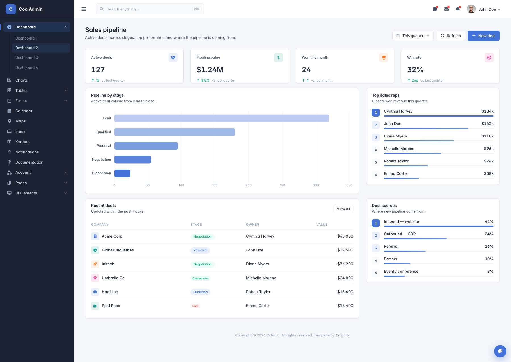
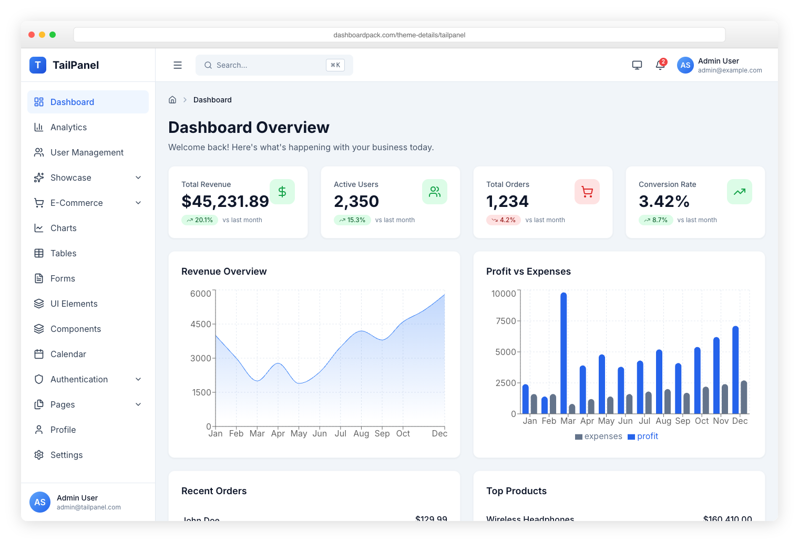
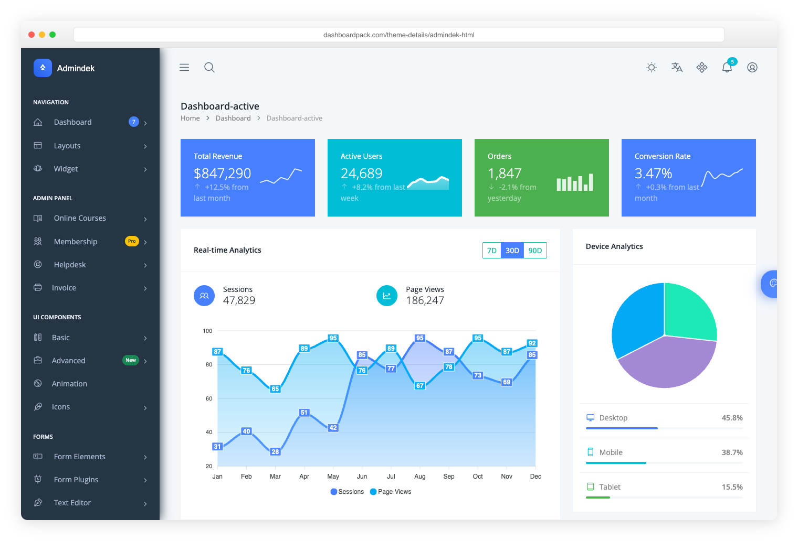

# CoolAdmin — Bootstrap 5 Admin Dashboard Template



[](CHANGELOG.md)
[](https://getbootstrap.com/)
[](LICENSE.md)

CoolAdmin is a free, MIT-licensed Bootstrap 5 dashboard template with **35 static pages**, **four dashboard layouts**, and **vanilla JavaScript**. Built HTML, CSS, and runtime libraries ship in the repository; end users need no Node toolchain. Contributors can edit shared Pug templates and SCSS sources.

- [Live demo](https://preview.colorlib.com/theme/cooladmin/)
- [Website and documentation](https://cooladmin.colorlib.com/)
- [Download ZIP](https://downloads.colorlib.com/theme/cooladmin.zip)
- [Release notes](docs/releases/v3.5.0.md) · [Full changelog](CHANGELOG.md) · [Contributor guide](AGENTS.md)

## What's new in v3.5.0 — October 13, 2026

- Updated Vite, Sass, concurrently, and FullCalendar to the latest stable npm releases verified on this date; refreshed the lockfile.
- Removed the **208,479-byte Chart.js script request from 23 pages** without chart canvases. Chart.js now loads on `index.html`, `index2.html`, `index3.html`, `card.html`, and `chart.html` only.
- Rebuilt FullCalendar 7.1.2 from its locked npm distribution with Terser. Its two scripts total **340,963 bytes raw / 95,797 bytes gzip**, compared with **803,469 / 164,748 bytes** previously. These figures exclude calendar CSS and do not measure page-load time or Core Web Vitals.
- Fixed directory watching for Chokidar 5, debounced saves, serialized Pug builds, and preserved unchanged output timestamps.
- Fixed detached chart instances during repeated dashboard refreshes; added `font-display: swap` to Poppins declarations.
- Added six Node regression tests and CI on Node 22/24, including committed asset consistency checks.

## Pages and features

The dashboard layouts cover operations (`index.html`), sales (`index2.html`), marketing (`index3.html`), and projects (`index4.html`). Apps include calendar, Leaflet maps, inbox, drag-and-drop kanban, sortable/filterable/paginated tables, invoices, profiles, pricing, and notifications. Component examples include forms, charts, buttons, cards, modals, tabs, alerts, progress bars, switches, typography, and icons. Auth and error pages provide frontend examples.

Shared interactions include a **Ctrl+K / Cmd+K command palette with substring search**, toast notifications, six persistent accent-color presets, mobile navigation, and dashboard loading skeletons. The command palette's `COMMANDS` array is maintained separately from sidebar navigation.

**Integration boundaries:** sample forms and auth pages need a backend for real persistence, authentication, payments, or email. Six accent presets ship; the app overlay does not provide a complete dark theme. Legacy Bootstrap dark tokens cover only part of the styles. Inter loads from `rsms.me`; the map page also uses Leaflet's CDN assets and external map tiles.

## Quick start — no build required

```bash
git clone https://github.com/puikinsh/CoolAdmin.git
cd CoolAdmin
python3 -m http.server 8000
```

Open `http://localhost:8000/index.html`. A local HTTP server avoids browser restrictions associated with `file://`.

## Contributor workflow

Use **Node >=22.12** and npm. Install the lockfile without changing dependency resolution:

```bash
npm ci
npm run dev                 # Pug + Sass watchers and Vite at localhost:3000
npm run build               # FullCalendar vendor assets, Pug HTML, Sass CSS
npm run build:vendor        # Calendar scripts/styles/license only
npm run build:pug           # Root HTML only
npm run build:sass          # Theme and app CSS only
npm test                    # Node regression tests
npm run check               # Full build plus tests
```

Edit sources, then commit their regenerated outputs together. Root `*.html`, `css/theme.css`, and `css/app.css` are generated deliverables. Vite is a development server; `vite build` is not the production pipeline. Watcher changes to shared fragments compile all pages but only write changed outputs. If one development process exits, concurrently stops its siblings.

## Repository structure

```text
src/pug/pages/                 One Pug entry per page
src/pug/layouts/               Dashboard, auth, and error layouts
src/pug/partials/              Shared head, navigation, headers, and scripts
src/pug/partials/content/      Page HTML and inline script/style fragments
src/scss/                     theme.scss, app.scss, and component partials
js/                           Shared vanilla browser logic
vendor/                       Vendored browser libraries
css/                          Built CSS and font declarations
images/, fonts/, media/       Runtime assets
screenshots/                  README and social images
test/                         Node regression tests
docs/                         Release and deployment documentation
scripts/                      Build helpers
*.html                        35 committed pages
```

`src/pug/partials/_nav-data.pug` drives sidebar and mobile navigation. Add palette entries to `COMMANDS` in `js/main-vanilla.js`. Preserve SCSS import order: the cascade depends on it. App overlay styles use `body.app` and `--m-*` design tokens.

## Dependencies

Stable npm releases verified on October 13, 2026:

| Library/tool | Version | Location/use |
| --- | --- | --- |
| Bootstrap | 5.3.8 | Vendored CSS and bundled JS |
| Chart.js | 4.5.1 | Vendored UMD bundle; five chart pages |
| FullCalendar | 7.1.2 | Calendar only; npm source and minified vendor output |
| Font Awesome Free | 7.3.1 | Vendored CSS and WOFF2 fonts |
| Hamburgers | 1.2.1 | Vendored CSS |
| Leaflet | 1.9.4 | Map-only CDN imports with integrity hashes |
| Chokidar | 5.0.0 | Pug source watching |
| concurrently | 10.0.6 | Development process orchestration |
| Pug | 3.0.4 | Template compilation |
| Sass | 1.105.1 | SCSS compilation |
| Vite | 8.3.4 | Development server |
| Terser | 5.51.2 | Calendar script minification |

When upgrading FullCalendar, rebuild its vendor files, update the versioned paths in `src/pug/pages/calendar.pug` and documentation, and remove the superseded vendor directory. Preserve license notices. Other vendored libraries are checked separately from `npm outdated`.

## Validation

`npm run check` covers local HTML/CSS asset references, conditional chart loading, calendar distribution/version, Pug build timestamps and errors, watcher add/change/unlink recovery, and repeated dashboard refresh chart cleanup. There is no coverage threshold or configured linter/formatter.

For v3.5.0, all 35 pages were checked in Chromium at **1440 px** and **390 px** with no console errors or failed requests. Calendar Month/Week/Day/List views, chart rendering, repeated refreshes, palette keyboard controls, accent themes, and mobile navigation were exercised. `npm audit` reported **zero vulnerabilities**; `npm outdated` reported no outdated direct npm packages. These are dated checks, not ongoing guarantees.

Validate your production browsers and backend integrations separately. No Lighthouse or Core Web Vitals score is claimed for this release.

## Deployment and releases

Publish only the built pages and required runtime assets to a static host. Do not expose `.git`, `node_modules`, credentials, or build tooling. Keep HTML and unversioned assets refreshable; use longer caches for versioned vendor filenames. See [deployment and release workflow](docs/DEPLOYMENT.md) for the existing R2 demo, downloadable archive, Pages website, verification, and rollback steps.

## Upgrade to a Premium Dashboard


Need advanced features, dedicated support, and production-ready code? Explore our handpicked collection of professional admin templates on [DashboardPack](https://dashboardpack.com/?utm_source=github&utm_medium=readme&utm_campaign=cooladmin).

<table>
  <tr>
    <td align="center" width="50%">
      <a href="https://dashboardpack.com/theme-details/apex-dashboard-nextjs/?utm_source=github&utm_medium=readme&utm_campaign=cooladmin">
        
      </a>
      <br>
      <a href="https://dashboardpack.com/theme-details/apex-dashboard-nextjs/?utm_source=github&utm_medium=readme&utm_campaign=cooladmin"><strong>Apex Dashboard</strong></a>
      <br>
      <sub>Next.js 16 + React 19 + Tailwind CSS v4 + shadcn/ui. 5 dashboard variants, 20+ app pages, 125+ routes, full CRUD.</sub>
    </td>
    <td align="center" width="50%">
      <a href="https://dashboardpack.com/theme-details/zenith-shadcn/?utm_source=github&utm_medium=readme&utm_campaign=cooladmin">
        
      </a>
      <br>
      <a href="https://dashboardpack.com/theme-details/zenith-shadcn/?utm_source=github&utm_medium=readme&utm_campaign=cooladmin"><strong>Zenith Dashboard</strong></a>
      <br>
      <sub>Next.js 16 + React 19 + Tailwind CSS v4 + shadcn/ui. Achromatic design, 50+ pages, 6 dashboards, live theme customizer.</sub>
    </td>
  </tr>
  <tr>
    <td align="center" width="50%">
      <a href="https://dashboardpack.com/theme-details/haze-dashboard-nuxt/?utm_source=github&utm_medium=readme&utm_campaign=cooladmin">
        
      </a>
      <br>
      <a href="https://dashboardpack.com/theme-details/haze-dashboard-nuxt/?utm_source=github&utm_medium=readme&utm_campaign=cooladmin"><strong>Haze</strong></a>
      <br>
      <sub>Nuxt 4 + Nuxt UI v4 + Tailwind CSS v4. 92+ pages, 7 layouts, 5 dashboards, RTL, i18n, mock API layer.</sub>
    </td>
    <td align="center" width="50%">
      <a href="https://dashboardpack.com/theme-details/tailpanel/?utm_source=github&utm_medium=readme&utm_campaign=cooladmin">
        
      </a>
      <br>
      <a href="https://dashboardpack.com/theme-details/tailpanel/?utm_source=github&utm_medium=readme&utm_campaign=cooladmin"><strong>TailPanel</strong></a>
      <br>
      <sub>React + TypeScript + Tailwind CSS + Vite. 9 dashboard designs, dark and light themes.</sub>
    </td>
  </tr>
  <tr>
    <td align="center" width="50%">
      <a href="https://dashboardpack.com/theme-details/admindek-html/?utm_source=github&utm_medium=readme&utm_campaign=cooladmin">
        
      </a>
      <br>
      <a href="https://dashboardpack.com/theme-details/admindek-html/?utm_source=github&utm_medium=readme&utm_campaign=cooladmin"><strong>Admindek</strong></a>
      <br>
      <sub>Bootstrap 5 + vanilla JS. 100+ components, dark/light modes, RTL support, 10 color presets.</sub>
    </td>
    <td align="center" width="50%">
      <a href="https://dashboardpack.com/theme-details/svelteforge-premium/?utm_source=github&utm_medium=readme&utm_campaign=cooladmin">
        
      </a>
      <br>
      <a href="https://dashboardpack.com/theme-details/svelteforge-premium/?utm_source=github&utm_medium=readme&utm_campaign=cooladmin"><strong>SvelteForge Premium</strong></a>
      <br>
      <sub>SvelteKit + Tailwind CSS v4. 30+ wired-up modules, multi-tenant from row zero, dark/light/system mode.</sub>
    </td>
  </tr>
</table>

<p align="center">
  <a href="https://dashboardpack.com/?utm_source=github&utm_medium=readme&utm_campaign=cooladmin"><strong>View All Premium Templates →</strong></a>
</p>

## License

[MIT](LICENSE.md). Commercial use, modification, and redistribution are permitted under the license terms. Third-party libraries retain their own licenses.
